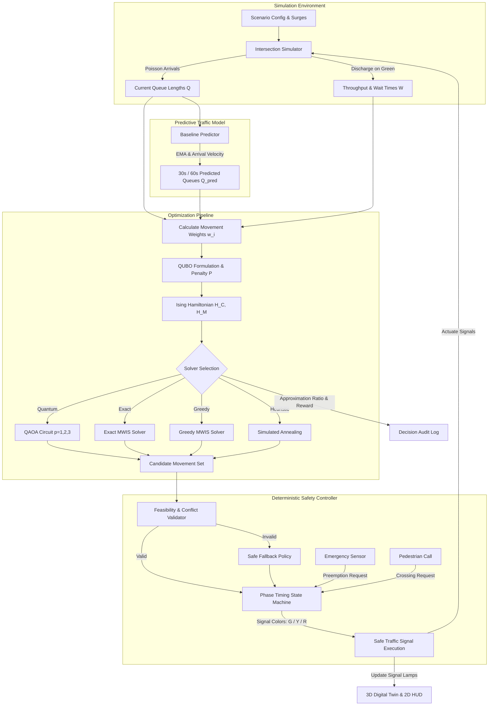

# GREEN-WAVE: Intelligent Quantum & Classical Traffic Optimization

[](https://www.python.org/)
[](https://qiskit.org/)
[](https://reactjs.org/)
[](https://threejs.org/)
[](https://tailwindcss.com/)
[](https://opensource.org/licenses/MIT)

> **GREEN-WAVE** is a research prototype and simulation-based decision-support system for urban traffic signal optimization. It formulates multi-corridor intersection scheduling as a **Maximum-Weight Independent Set (MWIS)** problem solved via **QUBO (Quadratic Unconstrained Binary Optimization)** and **QAOA (Quantum Approximate Optimization Algorithm)**, surrounded by a deterministic safety and clearance controller, a real-time predictive traffic model, and an interactive 3D digital twin.

---

## 📌 Table of Contents
1. [Overview & Project Genesis](#-overview--project-genesis)
2. [What Has Been Built Up to Now](#-what-has-been-built-up-to-now)
3. [System Architecture & End-to-End Workflow](#-system-architecture--end-to-end-workflow)
4. [Mathematical & Optimization Model](#-mathematical--optimization-model)
   - [Traffic Priority Weighting](#1-traffic-priority-weighting)
   - [QUBO & Ising Hamiltonian Formulation](#2-qubo--ising-hamiltonian-formulation)
   - [QAOA Quantum Circuit & Layers (p=1, p=2, p=3)](#3-qaoa-quantum-circuit--layers-p1-p2-p3)
5. [Operational Conditions & Safety Constraints](#-operational-conditions--safety-constraints)
   - [Conflict Graph & Collision Invariants](#1-conflict-graph--collision-invariants)
   - [Deterministic Clearance & State Machine](#2-deterministic-clearance--state-machine)
   - [Emergency Preemption & Pedestrian Safety](#3-emergency-preemption--pedestrian-safety)
   - [Autonomous Anti-Deadlock Watchdog](#4-autonomous-anti-deadlock-watchdog)
6. [Frontend & 3D Digital Twin Visualizer](#-frontend--3d-digital-twin-visualizer)
7. [Directory Structure](#-directory-structure)
8. [Getting Started & Installation](#-getting-started--installation)
9. [Running Tests](#-running-tests)
10. [Authors & Acknowledgments](#-authors--acknowledgments)

---

## 🔬 Overview & Project Genesis

Modern traffic signal control at complex 4-way junctions faces conflicting objectives: minimizing vehicle delay, clearing incoming traffic surges, avoiding starvation, ensuring pedestrian safety, and providing instant preemption for emergency vehicles.

Traditional actuated systems rely on static ring-barrier phase sequences or localized greedy heuristics. **GREEN-WAVE** re-envisions traffic control as an **adaptive graph optimization problem**:
- Traffic movements are modeled as nodes in an **intersection conflict graph** ($G = (V, E)$).
- Movements that cannot safely receive a green light simultaneously share an edge in $E$.
- The goal at every decision window ($5\text{s}$) is to identify the **Maximum-Weight Independent Set (MWIS)**—the set of mutually non-conflicting movements that maximizes overall traffic throughput and relieves the longest delays.

Because MWIS is NP-hard, GREEN-WAVE implements and evaluates **QAOA** running on Qiskit Aer simulators alongside three classical baselines (**Exact Branch-and-Bound Enumeration**, **Greedy MWIS**, and **Simulated Annealing**) to establish rigorous empirical benchmark comparisons.

---

## 🚀 What Has Been Built Up to Now

Over the course of development, the system has progressed from architectural design into a fully integrated, full-stack application:

1. **Quantum Optimization Core (`backend/app/optimization/`)**:
   - **QUBO & Ising Converters**: Maps 12-movement traffic weights and 28 conflict penalties into upper-triangular QUBO matrices and Ising Hamiltonians.
   - **QAOA Engine**: Parametric quantum circuit builder constructing multi-layer circuits ($p=1, 2, 3$) with statevector evaluation and COBYLA classical parameter tuning.
   - **Classical Solver Suite**: Exact brute-force enumeration, Greedy MWIS, and Simulated Annealing for live benchmark comparisons.
   - **Qiskit ASCII & Circuit Exporters**: Live generation of circuit diagrams and quantum state metrics.

2. **Predictive Traffic Model (`backend/app/prediction/`)**:
   - Sliding-window Exponential Moving Average (EMA) and net arrival velocity forecasting ($\Delta Q / \Delta t$) predicting queue depth at 30-second and 60-second horizons.

3. **Deterministic Safety Controller (`backend/app/safety/`)**:
   - Enforces physical clearance (Minimum Green $5.0\text{s}$, Yellow $3.0\text{s}$, All-Red $2.0\text{s}$).
   - Pedestrian Walk/Clearance phases.
   - Preemption corridors for emergency vehicles with immediate red overrides on conflicting approaches.
   - Fail-safe fallback policies if optimization results violate conflict constraints.

4. **Discrete-Event Simulation Engine (`backend/app/simulation/`)**:
   - Poisson vehicle arrivals calibrated across 7 scenarios (`balanced_peak`, `one_direction_heavy`, `sudden_surge`, `emergency_priority`, etc.).
   - Binomial saturation flow discharge model ($0.55\text{ veh/s}$).

5. **3D Spatial Digital Twin & Relevo-Vinco UI (`frontend/src/`)**:
   - **3D Intersection Visualizer**: Built with Three.js, featuring 4 approaches, 12 continuous bezier turning trajectories, independent 3-head gantries per lane, vehicle physics with forward radar, and emergency lighting.
   - **3D Quantum Waveguide Circuit**: Visualizes 12 quantum rails, single-qubit rotations, and 28 entangling $ZZ$ arches in 3D space.
   - **Decision Audit Log & Telemetry**: Real-time WebSocket streaming of live queue lengths, waiting times, and solver approximation ratios.

---

## 🏛 System Architecture & End-to-End Workflow



---

## 📐 Mathematical & Optimization Model

### 1. Traffic Priority Weighting
Every decision epoch ($5\text{s}$), each of the 12 movements ($M_0$ to $M_{11}$) receives a priority weight $w_i$:

$$w_i = \max\left(\alpha Q_i + \beta \hat{Q}_{i,\text{pred}} + \gamma W_i, \; w_{\text{min}}\right)$$

- $Q_i$: Current number of queued vehicles.
- $\hat{Q}_{i,\text{pred}}$: Predicted queue 30 seconds into the future.
- $W_i$: Normalized waiting time of the longest-waiting vehicle.
- $(\alpha = 1.0, \beta = 0.5, \gamma = 0.3, w_{\text{min}} = 0.1)$.

### 2. QUBO & Ising Hamiltonian Formulation
The problem of selecting the optimal non-conflicting subset of movements is formulated as a QUBO:

$$E(x) = -\sum_{i=1}^{12} w_i x_i + P \sum_{(i,j) \in E} x_i x_j$$

where $x_i \in \{0, 1\}$ and $P > \sum_i w_i$ is a penalty parameter that strictly penalizes conflicting movement combinations.

Using the substitution $x_i = \frac{1 - Z_i}{2}$, the QUBO is mapped to an Ising spin Hamiltonian:

$$H_C = \sum_{i=1}^{12} h_i Z_i + \sum_{(i,j) \in E} J_{ij} Z_i Z_j + C$$

### 3. QAOA Quantum Circuit & Layers ($p=1, p=2, p=3$)
QAOA prepares the ground state of $H_C$ by alternating applications of the Cost Hamiltonian $U_C(\gamma)$ and the Mixer Hamiltonian $U_M(\beta)$ starting from $|+\rangle^{\otimes 12}$:

$$|\psi(\boldsymbol{\gamma}, \boldsymbol{\beta})\rangle = \prod_{l=1}^p \left( e^{-i \beta_l H_M} e^{-i \gamma_l H_C} \right) |+\rangle^{\otimes 12}$$

#### Differences Between $p=1$, $p=2$, and $p=3$ in GREEN-WAVE

| Metric | $p = 1$ (Fast Execution) | $p = 2$ (Higher Precision) | $p = 3$ (Deep Ansätz) |
| :--- | :--- | :--- | :--- |
| **Parameters** $(\boldsymbol{\gamma}, \boldsymbol{\beta})$ | 2 $(\gamma_1, \beta_1)$ | 4 $(\gamma_1, \gamma_2, \beta_1, \beta_2)$ | 6 $(\gamma_1, \gamma_2, \gamma_3, \beta_1, \beta_2, \beta_3)$ |
| **Two-Qubit CNOT Gates** | **56** ($28 \text{ edges} \times 2$) | **112** ($28 \text{ edges} \times 4$) | **168** ($28 \text{ edges} \times 6$) |
| **Total Gate Count** | **120** | **228** | **336** |
| **Approx. Ratio** | $\approx 80\% - 90\%$ | $\approx 90\% - 97\%$ | $\approx 95\% - 100\%$ |
| **Latency** | $\approx 5 - 15\text{ms}$ | $\approx 25 - 55\text{ms}$ | $\approx 70 - 160\text{ms}$ |
| **Application** | Real-time low-latency control | Balanced operational default | Theoretical benchmark evaluation |

---

## 🛡 Operational Conditions & Safety Constraints

For the system to operate safely in simulated or physical environments, strict operational invariants are enforced:

### 1. Conflict Graph & Collision Invariants
The intersection consists of 12 movements across 4 approaches:
- **Through (T)**: `M0` (N), `M3` (S), `M6` (E), `M9` (W)
- **Left Turn (L)**: `M1` (N), `M5` (S), `M8` (E), `M10` (W)
- **Right Turn (R)**: `M2` (N), `M4` (S), `M7` (E), `M11` (W)

There are **28 conflict pairs** (e.g., $M_0$ vs $M_6$, $M_1$ vs $M_3$). Under no condition may two conflicting movements be green simultaneously.

### 2. Deterministic Clearance & State Machine
The quantum solver proposes candidates, but the deterministic state machine controls all transitions:
- **Minimum Green**: $5.0\text{s}$ (prevents rapid signal flickering).
- **Yellow Change Interval**: $3.0\text{s}$ (warns approaching drivers).
- **All-Red Clearance**: $2.0\text{s}$ (clears vehicles in the conflict box before cross traffic enters).
- **Maximum Green**: $45.0\text{s}$ (prevents starvation on minor approaches).

### 3. Emergency Preemption & Pedestrian Safety
- **Emergency Priority**: When an ambulance approaches, all conflicting movements immediately transition through yellow and all-red into **RED**. The ambulance corridor is locked to **GREEN** until clearance.
- **Pedestrian Crossing**: A pedestrian call schedules a dedicated walk interval ($7.0\text{s}$) and flashing clearance interval ($4.0\text{s}$), holding all conflicting vehicle turns.

### 4. Autonomous Anti-Deadlock Watchdog
In the 3D simulation environment, an autonomous watchdog monitors vehicle standstill durations:
- If a vehicle is held for $> 4.0\text{s}$ on green or inside an intersection turn pocket, and the physical path directly ahead is clear ($\text{gap} > 4.5\text{m}$), the watchdog disengages temporary yield locks and commands the vehicle to creep forward safely at $3.5\text{m/s}$, preventing deadlocks.

---

## 🖥 Frontend & 3D Digital Twin Visualizer

The user interface follows the **Relevo & Vinco** tactile, engineering-grade design language:

1. **3D Spatial Simulation**:
   - 3-lane physical approaches (Left, Through, Right).
   - Dedicated 3-head gantries per approach.
   - Photorealistic automotive geometries (sedans, SUVs, sports cars, ambulance).
   - Dynamic headlights, brake lights, amber turn blinkers, and rotating wheels.

2. **3D Quantum Circuit Visualizer**:
   - Interactive 12-qubit waveguide rail system.
   - 3D gates: Hadamard ($H$), Phase shifts ($R_Z$), Mixer rotations ($R_X$), and 28 spatial entangling arches representing $ZZ$ couplings.
   - Synchronized Qiskit ASCII circuit text view.

3. **Live Telemetry & Decision Audit Log**:
   - Real-time KPI gauges (Mean Wait, Total Queue, Throughput, Priority Delay).
   - Corridor demand meters ($M_{00} - M_{11}$).
   - Ledger recording timestamps, solvers, active movement sets, rewards, feasibility, and runtime latencies.

---

## 📂 Directory Structure

```text
GreenWave/
├── backend/
│   ├── app/
│   │   ├── api/             # FastAPI REST endpoints & WebSockets
│   │   ├── core/            # Configuration & application settings
│   │   ├── db/              # In-memory repository & persistence layer
│   │   ├── optimization/    # QUBO, Ising, QAOA, Exact, Greedy, SA solvers
│   │   ├── prediction/      # Sliding-window EMA queue predictor
│   │   ├── safety/          # State machine, conflict graph, preemption
│   │   ├── schemas/         # Pydantic data validation schemas
│   │   ├── services/        # RunManager simulation background thread
│   │   └── simulation/      # Intersection simulator, Poisson arrivals, scenarios
│   └── tests/               # Python test suite (15 unit tests)
├── frontend/
│   ├── src/
│   │   ├── components/      # React components (3D views, audit panel, controls)
│   │   ├── types/           # TypeScript interfaces & definitions
│   │   ├── App.tsx          # Root dashboard application
│   │   └── main.tsx         # Vite entry point
│   ├── index.html           # HTML template
│   └── vite.config.ts       # Vite configuration & backend proxy
├── docs/                    # Design specifications & architecture guides
├── run.py                   # Single-command startup script
└── README.md                # Project documentation
```

---

## ⚡ Getting Started & Installation

### Prerequisites
- **Python**: 3.10, 3.11, or 3.12
- **Node.js**: 18.x or 20.x
- **Git**

### Installation

1. **Clone the repository**:
   ```bash
   git clone https://github.com/siddardha-2006/GreenWave.git
   cd GreenWave
   ```

2. **Backend Setup**:
   ```bash
   python -m venv .venv
   # Windows:
   .venv\Scripts\activate
   # Linux/macOS:
   source .venv/bin/activate

   pip install -r requirements.txt  # Or install fastapi, uvicorn, qiskit, qiskit-aer, numpy
   ```

3. **Frontend Setup**:
   ```bash
   cd frontend
   npm install
   cd ..
   ```

4. **Launch GREEN-WAVE**:
   ```bash
   python run.py
   ```
   Open your browser to **`http://localhost:5173`**.

---

## 🧪 Running Tests

### Backend Unit Tests
Execute the unit test suite covering QUBO generation, QAOA circuits, exact solvers, and safety invariants:
```bash
python -m unittest discover -s backend/tests -p "test_*.py"
```
*Expected: 15/15 tests passing.*

### Frontend Build Verification
Verify TypeScript compilation and asset bundling:
```bash
cd frontend
npm run build
```

---

## 👥 Authors & Acknowledgments

- **Lead Developer**: Siddardha Yarlagadda ([@siddardha-2006](https://github.com/siddardha-2006))
- **Research Framework**: Quantum Approximate Optimization Algorithm (QAOA) applied to Maximum Weight Independent Sets for urban intelligent transport systems.
