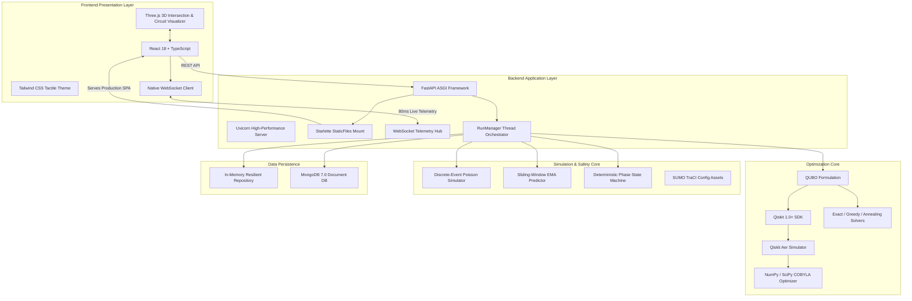

# GREEN-WAVE Technology Stack

This document provides a comprehensive breakdown of the entire technology stack powering **GREEN-WAVE**, detailing **where** each technology is utilized in the repository and **why** it was chosen for that specific architectural responsibility.

---

## 📑 Table of Contents
1. [Architectural Layer Overview](#-architectural-layer-overview)
2. [Quantum Computing & Mathematical Optimization](#1-quantum-computing--mathematical-optimization)
3. [Backend Web & Microservices Layer](#2-backend-web--microservices-layer)
4. [Persistence & Data Layer](#3-persistence--data-layer)
5. [Frontend & User Interface Layer](#4-frontend--user-interface-layer)
6. [3D Spatial Simulation & Digital Twin](#5-3d-spatial-simulation--digital-twin)
7. [Simulation & Traffic Modeling](#6-simulation--traffic-modeling)
8. [DevOps, Packaging & Deployment](#7-devops-packaging--deployment)
9. [Tech Stack Summary Matrix](#-tech-stack-summary-matrix)

---

## 🏛 Architectural Layer Overview

---

## 1. Quantum Computing & Mathematical Optimization

### ⚛️ Qiskit (`qiskit>=1.0.0`)
- **Where It Is Used**:
  - [`backend/app/optimization/qaoa_circuit.py`](file:///c:/Users/ramuk/OneDrive/Documents/GreenWave/backend/app/optimization/qaoa_circuit.py): Builds the parametric quantum circuit ansatz ($H^{\otimes 12} \to [U_C(\gamma) U_M(\beta)]^p$).
  - [`backend/app/optimization/qaoa_solver.py`](file:///c:/Users/ramuk/OneDrive/Documents/GreenWave/backend/app/optimization/qaoa_solver.py): Manages quantum registers, parameter vectors, and measurement sampling.
  - [`demo_quantum_circuit.py`](file:///c:/Users/ramuk/OneDrive/Documents/GreenWave/demo_quantum_circuit.py): Standalone CLI demonstration script.
- **Why It Is Used**:
  - The industry-standard open-source quantum computing framework.
  - Provides native support for parameterized quantum circuits (`ParameterVector`), symbolic angle binding, and direct translation of Ising Hamiltonians into quantum gate operations ($R_Z, R_X, \text{CNOT}$).

---

### 🚀 Qiskit Aer (`qiskit-aer>=0.14.0`)
- **Where It Is Used**:
  - [`backend/app/optimization/qaoa_solver.py`](file:///c:/Users/ramuk/OneDrive/Documents/GreenWave/backend/app/optimization/qaoa_solver.py#L75): Initializes the `AerSimulator` instance.
- **Why It Is Used**:
  - High-performance, C++ optimized quantum simulator backend.
  - Enables execution of quantum circuits locally on classical hardware without relying on physical QPU cloud access fees, network latency, or job queuing.
  - Supports both **statevector evaluation** (for noise-free classical parameter optimization) and **multi-shot sampling** (for empirical measurement distributions).

---

### 🧮 NumPy (`numpy>=1.26.0`) & SciPy (`scipy>=1.12.0`)
- **Where It Is Used**:
  - [`backend/app/optimization/qubo.py`](file:///c:/Users/ramuk/OneDrive/Documents/GreenWave/backend/app/optimization/qubo.py): Matrix construction for the upper-triangular QUBO matrix $Q \in \mathbb{R}^{12 \times 12}$.
  - [`backend/app/optimization/exact_solver.py`](file:///c:/Users/ramuk/OneDrive/Documents/GreenWave/backend/app/optimization/exact_solver.py): Vectorized bitmask evaluation over all $2^{12} = 4,096$ states.
  - [`backend/app/optimization/qaoa_solver.py`](file:///c:/Users/ramuk/OneDrive/Documents/GreenWave/backend/app/optimization/qaoa_solver.py#L115): Classical outer-loop parameter optimization (`scipy.optimize.minimize` using `COBYLA`).
  - [`backend/app/prediction/baseline_predictor.py`](file:///c:/Users/ramuk/OneDrive/Documents/GreenWave/backend/app/prediction/baseline_predictor.py): Arrival rate velocity and queue trend computations.
- **Why It Is Used**:
  - High-speed array manipulations, vectorized matrix-vector products ($x^T Q x$), and gradient-free optimization algorithms (COBYLA) critical for fast classical convergence during QAOA parameter tuning.

---

## 2. Backend Web & Microservices Layer

### 🐍 Python 3.10 / 3.11 / 3.12
- **Where It Is Used**:
  - The entire backend application, simulation logic, predictive models, and unit tests.
- **Why It Is Used**:
  - Native runtime for scientific computing, quantum computing SDKs (Qiskit), and high-concurrency asynchronous web frameworks.

---

### ⚡ FastAPI (`fastapi>=0.110.0`)
- **Where It Is Used**:
  - [`backend/app/main.py`](file:///c:/Users/ramuk/OneDrive/Documents/GreenWave/backend/app/main.py): Application entry point, CORS middleware, lifespan events, and static file mounting.
  - [`backend/app/api/routes.py`](file:///c:/Users/ramuk/OneDrive/Documents/GreenWave/backend/app/api/routes.py): REST API endpoints (`/api/experiments`, `/api/scenarios`, `/api/quantum/circuit`, `/health`).
- **Why It Is Used**:
  - High-performance asynchronous ASGI web framework based on Starlette and Pydantic.
  - Built-in WebSocket handling, automated OpenAPI/Swagger documentation generation, and dependency injection.
  - Native asynchronous event loops allowing non-blocking I/O while running background simulation threads.

---

### 🦄 Uvicorn (`uvicorn[standard]>=0.28.0`)
- **Where It Is Used**:
  - [`run.py`](file:///c:/Users/ramuk/OneDrive/Documents/GreenWave/run.py), `backend/app/main.py`, and Docker entrypoint.
- **Why It Is Used**:
  - High-throughput ASGI server implementation based on `uvloop` and `httptools`.
  - Capable of sustaining thousands of concurrent WebSocket connections and persistent HTTP streams with minimal CPU overhead.

---

### 🔄 WebSockets (`websockets>=12.0` / FastAPI WebSockets)
- **Where It Is Used**:
  - [`backend/app/api/routes.py`](file:///c:/Users/ramuk/OneDrive/Documents/GreenWave/backend/app/api/routes.py#L90): `/ws/experiments/{exp_id}` streaming endpoint.
  - [`backend/app/services/run_manager.py`](file:///c:/Users/ramuk/OneDrive/Documents/GreenWave/backend/app/services/run_manager.py#L117-L131): Broadcasts telemetry snapshots to all subscribed clients.
  - [`frontend/src/App.tsx`](file:///c:/Users/ramuk/OneDrive/Documents/GreenWave/frontend/src/App.tsx#L80-L125): Frontend WebSocket listener.
- **Why It Is Used**:
  - Delivers high-frequency (80ms tick) telemetry, queue updates, signal states, and solver decisions with sub-millisecond network latency, avoiding the excessive overhead of repeated HTTP polling.

---

### 📦 Pydantic (`pydantic>=2.6.0`)
- **Where It Is Used**:
  - [`backend/app/schemas/experiment.py`](file:///c:/Users/ramuk/OneDrive/Documents/GreenWave/backend/app/schemas/experiment.py): Request/Response validation models.
  - [`backend/app/core/config.py`](file:///c:/Users/ramuk/OneDrive/Documents/GreenWave/backend/app/core/config.py): Environment configuration schema.
- **Why It Is Used**:
  - Fast, Rust-backed data validation and serialization.
  - Ensures strong typing and contract consistency between frontend payloads and backend data models.

---

### 📁 Starlette StaticFiles
- **Where It Is Used**:
  - [`backend/app/main.py`](file:///c:/Users/ramuk/OneDrive/Documents/GreenWave/backend/app/main.py#L55-L60): Mounts `frontend/dist` at `/`.
- **Why It Is Used**:
  - Enables single-container unified deployment: the FastAPI backend serves both the compiled React frontend assets and the live API/WebSocket services on a single port (`8000`), completely eliminating cross-origin resource sharing (CORS) complexity in production.

---

## 3. Persistence & Data Layer

### 🍃 MongoDB 7.0 & PyMongo (`pymongo>=4.6.0`)
- **Where It Is Used**:
  - [`backend/app/db/repository.py`](file:///c:/Users/ramuk/OneDrive/Documents/GreenWave/backend/app/db/repository.py): Persistent collections (`experiments`, `simulation_metrics`, `solver_results`).
  - [`docker-compose.yml`](file:///c:/Users/ramuk/OneDrive/Documents/GreenWave/docker-compose.yml): Official `mongo:7` container service.
- **Why It Is Used**:
  - Flexible document storage ideal for polymorphic simulation time-series metrics, dynamic queue dictionaries, and unstructured solver audit payloads.

---

### 💾 In-Memory Resilient Repository
- **Where It Is Used**:
  - [`backend/app/db/repository.py`](file:///c:/Users/ramuk/OneDrive/Documents/GreenWave/backend/app/db/repository.py#L39-L45): In-memory Python dictionaries with thread-safe locks.
- **Why It Is Used**:
  - Provides a 100% functional standalone fallback that activates automatically when a MongoDB server is not running, ensuring that developers or evaluators can run the system immediately without spinning up external databases.

---

## 4. Frontend & User Interface Layer

### ⚛️ React 18 (`react`, `react-dom`)
- **Where It Is Used**:
  - [`frontend/src/App.tsx`](file:///c:/Users/ramuk/OneDrive/Documents/GreenWave/frontend/src/App.tsx) and all UI component modules.
- **Why It Is Used**:
  - Declarative component architecture with concurrent rendering and optimized DOM reconciliation.
  - Powers the state management of live simulation metrics, user parameter controls, camera presets, and interactive circuit views.

---

### 📘 TypeScript 5.x
- **Where It Is Used**:
  - All source files across [`frontend/src/`](file:///c:/Users/ramuk/OneDrive/Documents/GreenWave/frontend/src/).
- **Why It Is Used**:
  - Static type safety and compile-time error detection.
  - Guarantees strict type alignment with backend models via [`frontend/src/types/index.ts`](file:///c:/Users/ramuk/OneDrive/Documents/GreenWave/frontend/src/types/index.ts).

---

### ⚡ Vite 5.x
- **Where It Is Used**:
  - [`frontend/vite.config.ts`](file:///c:/Users/ramuk/OneDrive/Documents/GreenWave/frontend/vite.config.ts): Build configuration and development server.
- **Why It Is Used**:
  - Lightning-fast development server with native ES-module Hot Module Replacement (HMR).
  - High-performance production bundler utilizing Rollup and ESBuild for tree-shaking and minification.

---

### 🎨 Tailwind CSS 3.4
- **Where It Is Used**:
  - [`frontend/tailwind.config.js`](file:///c:/Users/ramuk/OneDrive/Documents/GreenWave/frontend/tailwind.config.js), [`frontend/src/index.css`](file:///c:/Users/ramuk/OneDrive/Documents/GreenWave/frontend/src/index.css).
- **Why It Is Used**:
  - Utility-first CSS framework enabling rapid styling.
  - Implements the custom **Relevo & Vinco** tactile industrial aesthetic (embossed plates, debossed wells, brass accents, mono typography, and high-contrast dark mode).

---

### 🔣 Lucide React
- **Where It Is Used**:
  - [`frontend/src/components/`](file:///c:/Users/ramuk/OneDrive/Documents/GreenWave/frontend/src/components/): UI icons (play, pause, emergency, alerts, chevron indicators).
- **Why It Is Used**:
  - Lightweight, customizable SVG icon set optimized for React.

---

## 5. 3D Spatial Simulation & Digital Twin

### 🌐 Three.js (`three`)
- **Where It Is Used**:
  - [`frontend/src/components/Realistic3DIntersection.tsx`](file:///c:/Users/ramuk/OneDrive/Documents/GreenWave/frontend/src/components/Realistic3DIntersection.tsx): 3D digital twin of the intersection.
  - [`frontend/src/components/QuantumCircuitVisualizer.tsx`](file:///c:/Users/ramuk/OneDrive/Documents/GreenWave/frontend/src/components/QuantumCircuitVisualizer.tsx): 3D quantum waveguide circuit visualizer.
- **Why It Is Used**:
  - Standard WebGL rendering engine for browser-based 3D graphics.
  - Features used in GREEN-WAVE:
    - **PCFShadowMap**: Directional sunlight and shadow casting.
    - **Continuous Bézier Trajectories**: Mathematical turning curves across the intersection quadrant.
    - **Physical Automotive Geometry**: Procedurally built vehicle chassis, headlights, brake lights, rotating wheels, and steer pivots.
    - **Dynamic PointLights**: Independent gantry signal illumination and pulsating emergency ambulance strobes.
    - **Forward Collision Radar**: Continuous vector projection ($s, w, \text{align}$) preventing rear-end collisions.

---

### 🕹 Three.js OrbitControls
- **Where It Is Used**:
  - [`frontend/src/components/Realistic3DIntersection.tsx`](file:///c:/Users/ramuk/OneDrive/Documents/GreenWave/frontend/src/components/Realistic3DIntersection.tsx#L104), [`frontend/src/components/QuantumCircuitVisualizer.tsx`](file:///c:/Users/ramuk/OneDrive/Documents/GreenWave/frontend/src/components/QuantumCircuitVisualizer.tsx#L85).
- **Why It Is Used**:
  - Provides smooth, damped 3D camera navigation (pan, tilt, zoom).
  - Supports 4 programmatic camera presets: **Perspective**, **Top-Down (Bird's Eye)**, **Driver POV**, and **Close-Up**.

---

## 6. Simulation & Traffic Modeling

### 🚦 Discrete-Event Simulator Engine
- **Where It Is Used**:
  - [`backend/app/simulation/simulator.py`](file:///c:/Users/ramuk/OneDrive/Documents/GreenWave/backend/app/simulation/simulator.py).
- **Why It Is Used**:
  - Lightweight, deterministic discrete-event traffic simulator.
  - Models stochastic Poisson vehicle arrivals, queue discharge under green intervals using binomial saturation flow ($0.55\text{ veh/s}$), and timed scenario demand surges.

---

### 📈 Sliding-Window Predictive Model
- **Where It Is Used**:
  - [`backend/app/prediction/baseline_predictor.py`](file:///c:/Users/ramuk/OneDrive/Documents/GreenWave/backend/app/prediction/baseline_predictor.py).
- **Why It Is Used**:
  - Online queue forecasting using Exponential Moving Average (EMA) and net arrival velocity ($\Delta Q / \Delta t$) predicting 30s and 60s demand horizons with zero training overhead.

---

### 🗺 SUMO (Simulation of Urban MObility) Integration Assets
- **Where It Is Used**:
  - [`simulation/networks/`](file:///c:/Users/ramuk/OneDrive/Documents/GreenWave/simulation/networks/), [`simulation/routes/`](file:///c:/Users/ramuk/OneDrive/Documents/GreenWave/simulation/routes/), [`simulation/sumo_configs/`](file:///c:/Users/ramuk/OneDrive/Documents/GreenWave/simulation/sumo_configs/).
- **Why It Is Used**:
  - Industry-standard microscopic traffic simulator network definitions (`.nod.xml`, `.edg.xml`, `.con.xml`, `.rou.xml`, `.sumocfg`) providing readiness for TraCI (Traffic Control Interface) hardware-in-the-loop deployments.

---

## 7. DevOps, Packaging & Deployment

### 🐳 Docker & Multi-Stage Builds
- **Where It Is Used**:
  - [`Dockerfile`](file:///c:/Users/ramuk/OneDrive/Documents/GreenWave/Dockerfile).
- **Why It Is Used**:
  - Multi-stage build pattern:
    - **Stage 1 (`node:20-alpine`)**: Builds and minifies the React Three.js frontend.
    - **Stage 2 (`python:3.11-slim`)**: Packages the Python backend runtime, installing Qiskit and copying the compiled frontend assets into a lightweight (~350MB) container.
  - Guarantees 100% reproducible execution across development, local testing, and production cloud environments.

---

### 🐙 Docker Compose
- **Where It Is Used**:
  - [`docker-compose.yml`](file:///c:/Users/ramuk/OneDrive/Documents/GreenWave/docker-compose.yml).
- **Why It Is Used**:
  - 1-command orchestration spinning up the unified application container alongside MongoDB with volume persistence and health checks.

---

## 📊 Tech Stack Summary Matrix

| Category | Technology | Primary Role in GREEN-WAVE |
| :--- | :--- | :--- |
| **Quantum Computing** | Qiskit 1.0+ | QAOA parameterized circuit synthesis & Ising operators |
| **Quantum Simulation** | Qiskit Aer | Statevector optimization & shot measurement simulation |
| **Scientific Math** | NumPy / SciPy | QUBO matrix algebra & COBYLA classical parameter tuning |
| **Backend Runtime** | Python 3.11 | Core optimization, simulation, and predictive engine |
| **Backend Framework** | FastAPI | High-throughput asynchronous REST API & WebSocket server |
| **ASGI Server** | Uvicorn | High-concurrency production web server |
| **Real-Time Streaming**| WebSockets | 80ms live simulation telemetry & decision broadcast |
| **Data Validation** | Pydantic v2 | Schema validation & environment configuration |
| **Database** | MongoDB 7.0 | Time-series metrics & solver benchmark persistence |
| **Resilient Fallback** | In-Memory Repo | Standalone zero-configuration database fallback |
| **Frontend Framework** | React 18 | Reactive dashboard & state orchestration |
| **Type System** | TypeScript 5 | End-to-end static type enforcement |
| **Frontend Build** | Vite 5 | Rapid HMR dev server & production Rollup bundling |
| **Styling & UI** | Tailwind CSS 3.4 | Tactile Relevo & Vinco industrial aesthetic |
| **Icons** | Lucide React | Lightweight SVG status and navigation icons |
| **3D Graphics** | Three.js | WebGL 3D intersection & quantum circuit visualizer |
| **3D Controls** | OrbitControls | Pan, zoom, tilt, and preset viewing angles |
| **Traffic Simulation** | Discrete-Event Engine | Poisson vehicle arrivals & saturation flow discharge |
| **Traffic Prediction** | Baseline Predictor | Sliding-window EMA & arrival velocity forecasting |
| **SUMO Assets** | TraCI / XML Configs | Microscopic network definitions & co-simulation readiness |
| **Containerization** | Docker | Multi-stage production container image build |
| **Orchestration** | Docker Compose | 1-click multi-container local & cloud deployment |
